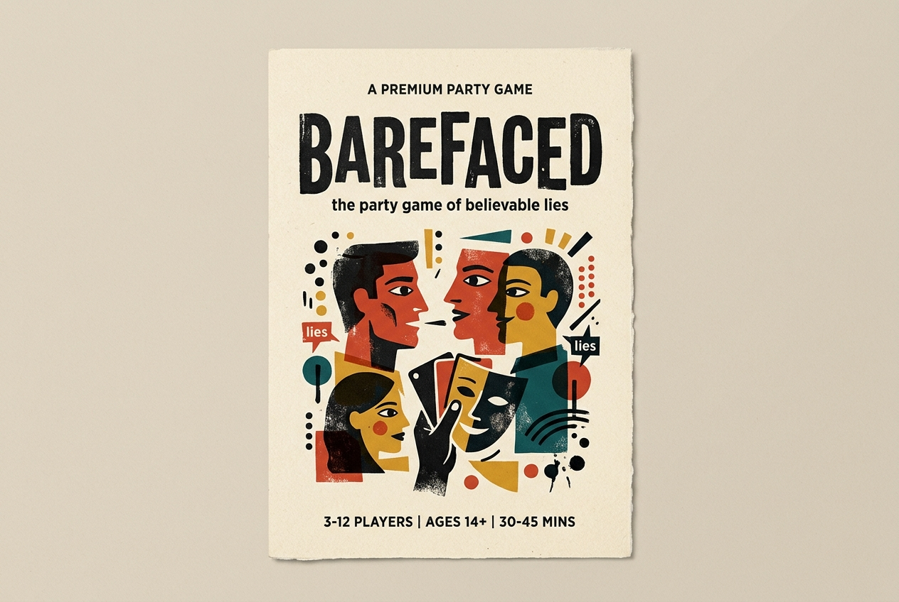
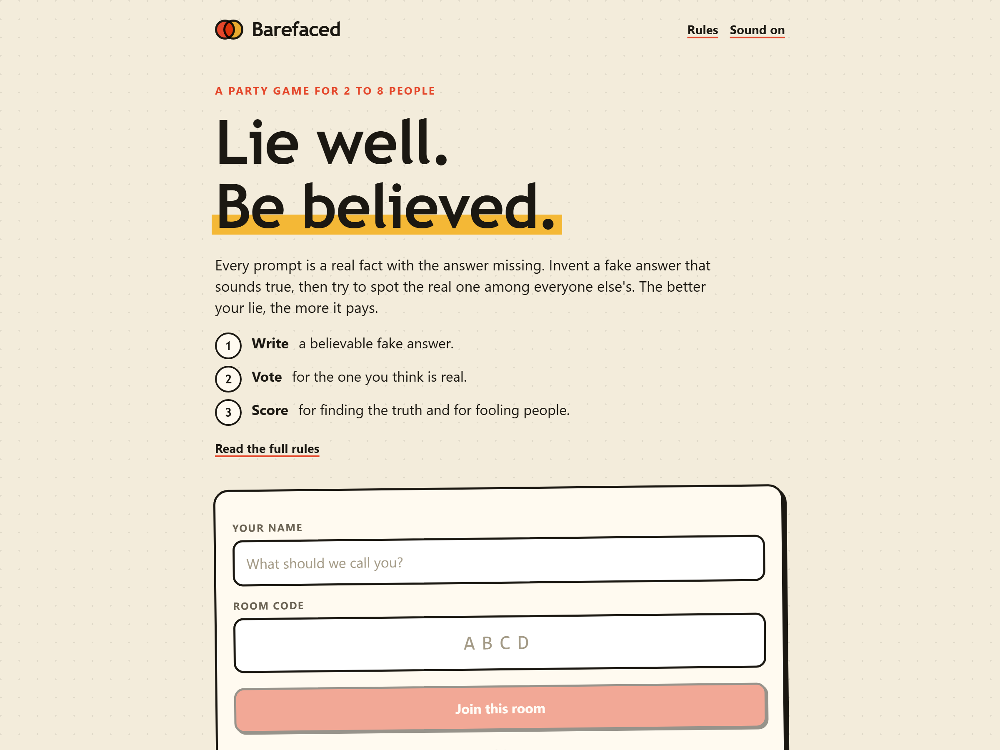
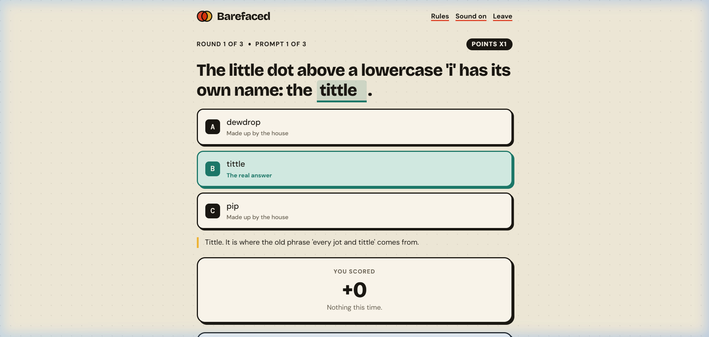
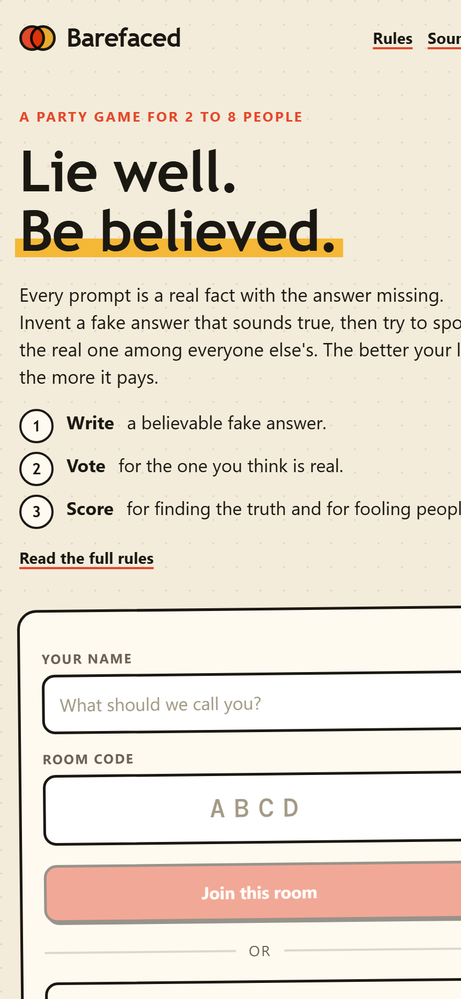
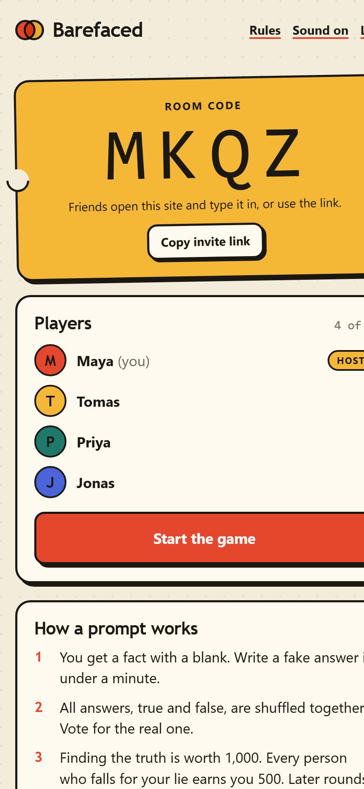

<div align="center">

# Barefaced
### *The Party Game of Believable Lies*

[](https://github.com/kallal79/barefaced/actions)
[](https://opensource.org/licenses/MIT)
[](https://guileless-manatee-3677be.netlify.app)

A real-time multiplayer bluffing party game for 2 to 8 players.  
Join from any smartphone, tablet, or laptop with a 4-letter room code. No accounts, no installs, and no emojis.

** Play it live right now: [https://guileless-manatee-3677be.netlify.app](https://guileless-manatee-3677be.netlify.app)**

<br />



</div>

---

##  What is Barefaced?

**Barefaced** is a party game about bluffing, observation, and plausible deception inspired by tabletop favorites like *Balderdash* and *Fibbage*.

Every round presents players with a verified, obscure historical or scientific fact that has one key word or phrase missing. Players secretly submit their own convincing fake answer, then everyone votes to spot the truth among the lies.

The trick? If you write a lie that sounds believable enough to fool your friends, you pocket the points they thought they were scoring.

<div align="center">
  
</div>

---

##  How It Works (The 3-Step Loop)

1. **Write (50s / 45s / 40s)**: A real fact appears with a blank (e.g., *"The very first item ever sold on eBay was a broken ______"*). Players type a convincing lie. A built-in fuzzy matching engine rejects submissions that match or closely resemble the truth.
2. **Vote (25s)**: All player lies, house decoys, and the true answer are shuffled together. Players vote on which option they believe is real. You cannot vote for your own lie. If two players invent the same lie, they are merged into one option and both earn points!
3. **Score & Reveal**:
   - **Finding the Truth**: Awards **+1,000 points**.
   - **Fooling Opponents**: Awards **+500 points** for each player who fell for your lie.
4. **3 Escalating Rounds & Match Length Presets**:
   - **Match Lengths**: Quick Sprint (1 Round • 3 Prompts), Standard Show (3 Rounds • 9 Prompts), or Marathon (5 Rounds • 15 Prompts).
   - **Round 1**: 1x point multiplier.
   - **Round 2**: 2x point multiplier with stranger facts and Double Down wagers.
   - **Round 3**: 3x point multiplier with fewer decoys and high-stakes showdown.
5. **Tactical Lifelines & Studio Soundboard**:
   - **Truth Shield**: Protects against losing points when tricked by rival bluffs.
   - **Bluff Trap**: Rig your own lie to steal bonus points from unsuspecting players.
   - **50/50 Lie Radar**: Sweeps the board to eliminate 50% of false answers.
   - **Studio Soundboard**: Instant live reaction SFX pads (Airhorn, Rimshot, Applause, Ka-Ching, Crickets, Drama Sting, Cheer).
6. **End-of-Game Awards & 3D Podium**: Celebrates top performers with Olympic podium, dynamic player titles (e.g. *Master Bamboozler*, *Eagle-Eye Detective*), and the **Hall of Deception**.

<div align="center">
  
</div>

---

## 🛠️ Technical Highlights

- **Serverless Real-Time Multiplayer**: Built with a standard Netlify Function at `netlify/functions/game.ts` called directly at `/.netlify/functions/game`.
- **Strong Consistency & Optimistic Concurrency**: Uses `@netlify/blobs` with `consistency: 'strong'` and HTTP ETag conditional writes (`onlyIfMatch` / `onlyIfNew`). If two players submit an action at the exact same millisecond, the loser automatically retries against the latest room snapshot, preventing lost updates.
- **Offline / Local Dev Fallback**: When running outside of Netlify, an in-memory store mimics identical ETag concurrency semantics, so developers can test locally with zero API keys or database setup.
- **Anti-Cheat Data Masking**: The answer key and question notes are concealed server-side during the write and vote phases. Even inspecting client network packets reveals no clues.
- **Web Audio Synthesizer & Soundboard**: Pure Web Audio API sound effects, procedural lounge music, and hostess speech synthesis that require zero external audio assets.
- **Tactile Paper Aesthetic**: Custom editorial design using `Bricolage Grotesque`, `DM Sans`, and `DM Mono` with offset shadows, warm cream tones, and colored initial badges.

---

## 📸 Screenshots

<div align="center">
  
  &nbsp;&nbsp;&nbsp;&nbsp;
  
</div>

---

## 🚀 Getting Started Locally

### Prerequisites
- Node.js 18+ (tested on Node 22 & 26)
- npm 9+

### Installation
```bash
git clone https://github.com/kallal79/barefaced.git
cd barefaced
npm install
```

### Running Development Server
```bash
npm run dev
```
Open [http://localhost:5173](http://localhost:5173) in your browser. Open a second tab or window to join as Player 2. Each tab maintains an independent session.

### Running Test Suite
```bash
npm test
```
Runs the 20-point automated end-to-end test suite covering prompt pools, fuzzy answer normalization, concurrency, 3-round scoring, match length presets, tactical lifelines, and timer auto-progression.

### Production Build
```bash
npm run build
```

---

## 📄 License

This project is licensed under the [MIT License](LICENSE).
